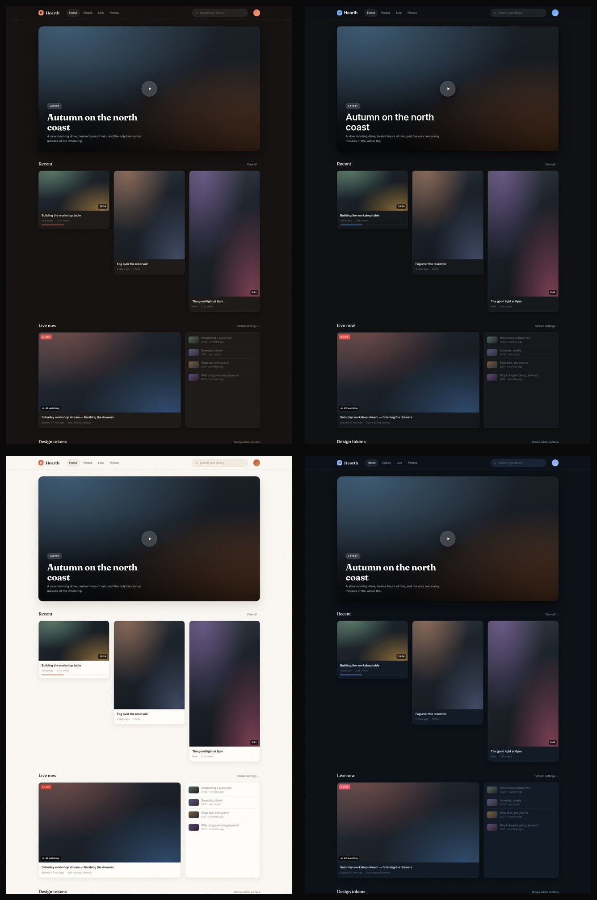

<div align="center">

# Cove

**A self-hostable, federated home for your videos, livestreams and photos.**

One person owns the instance. Anyone with the link can watch.
Your instance is your identity — `@you@your-domain`.

</div>

---

Cove unifies three things that are normally three separate products — long-form video, livestreaming, and photo/reel feeds — into a single, calm, good-looking site you run yourself. It is not a social network and not a multi-user platform: it is a **personal broadcast home**, which is what makes it small enough to actually self-host well.

> **Status: Phase 1 in progress** — the media pipeline works end to end: an upload becomes a published, playable HLS video, produced by a worker that is running now. What remains is the web half (upload endpoint, watch page, library). Evidence logs: [docs/PHASE-0.md](docs/PHASE-0.md) and [docs/PHASE-1.md](docs/PHASE-1.md), both of which record where reality disagreed with the plan.

## Why it exists

Most self-hosted media tools look like an admin panel. Cove is built around a design system with warm surfaces, ambient colour pulled from your own media, and no dark patterns — no autoplay with sound, no notification badges, no infinite-scroll pressure.

The full product and engineering plan lives in **[docs/PLAN.md](docs/PLAN.md)**, including:

- the unifying idea (video, live and photos are one `post` with three shapes)
- the design language and theming system
- the three media pipelines, with the actual `ffmpeg` invocations
- the decentralization design ([§6.5](docs/PLAN.md)) — ActivityPub via [Fedify](https://fedify.dev/)
- the self-hosting contract and the seven-phase roadmap
- verified research briefs in [`docs/research/`](docs/research)

## Design direction

A working mockup is in [`docs/design-preview.html`](docs/design-preview.html) — open it in a browser and switch presets with `?theme=cove|studio|paper|midnight`.



## Roadmap at a glance

| Phase | What lands |
| --- | --- |
| **0 — Foundation** ✅ | Monorepo, design tokens, Postgres-backed theming, the federation seams, compose stack, setup wizard, doctor |
| 1 — Video core | ✅ probe + remux-or-transcode + HLS + worker · ⏳ upload endpoint, watch page, library |
| 2 — Admin & theming | Setup wizard UI, passkeys, theme editor with contrast guardrails |
| 3 — Photos, reels & feed | Image pipeline, blur-up placeholders, the mixed masonry feed |
| 4 — Live *(optional profile)* | MediaMTX, WHEP with LL-HLS fallback, ephemeral chat, record → VOD |
| 5 — Decentralization | ActivityPub via Fedify, broadcast-first, optional P2P delivery |
| 6 — Comfort & polish | Search, playlists, feeds, embeds, stats-lite |
| 7 — Release hardening | Tested backup/restore, N-1 upgrade path, multi-arch images |

A site you would actually use daily arrives at the end of **Phase 1**, which is most of
the way there: the pipeline that turns a file into a streamable video is done and verified.

## Repository layout

```
cove/
├─ apps/
│  ├─ web/          # Next.js: UI, JSON API, auth, federation endpoints
│  └─ worker/       # Media jobs: ffmpeg, images, thumbnails
├─ packages/
│  ├─ db/           # Drizzle schema, migrations, settings
│  ├─ media/        # ffmpeg + sharp pipelines (pure, testable)
│  ├─ shared/       # Canonical URIs, visibility, env parsing
│  └─ ui/           # Design tokens, theme presets, primitives
├─ deploy/          # Caddy config, Quadlet units for systemd
├─ docs/            # PLAN.md, design mockup, research briefs
└─ scripts/         # doctor.sh — preflight checks
```

## Self-hosting

Not ready yet — the stack arrives with the Phase 0 completion and hardens through Phase 2. The goal it is being held to:

```bash
git clone <this repo> && cd cove
./setup.sh              # asks a few questions, generates secrets, runs preflight checks
podman compose up -d    # or: docker compose up -d
```

No mandatory reverse proxy, no mandatory Redis, no mandatory S3, and no mandatory SMTP. Postgres is in the stack, Caddy handles TLS automatically, and `./setup.sh doctor` prints a copy-pasteable fix for whatever is wrong.

## License

[AGPL-3.0-or-later](LICENSE).

Cove is meant to be self-hosted by anyone, including commercially; the AGPL keeps the code open for everyone using it as a network service. If you would rather build on it permissively, say so early — this is easy to revisit before there are outside contributions.
