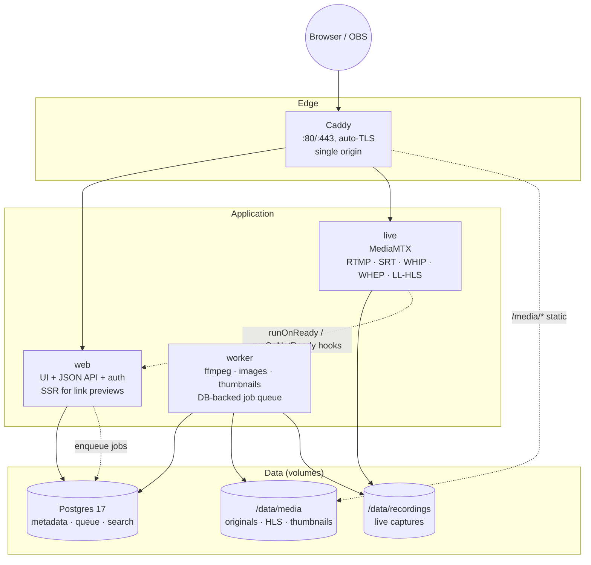

# Personal Media Site — Product & Engineering Plan

> Working title: **TBD** (see [§2 Naming](#2-naming-shortlist)). Codename in this doc: **`hearth`**.
> **Status:** plan complete. Decentralization is decided — **ActivityPub via Fedify** ([§12.1](#121-decided)). Hosting target is deliberately deferred, so the plan stays hardware-agnostic.

---

## 0. The one-paragraph version

A single-tenant, self-hostable personal media site: **one person owns the instance**, and anyone they share a link with can watch. It unifies three things that are normally three separate products — long-form **videos** (YouTube), **livestreams** (Twitch), and **photos / reels / shorts** (Instagram) — into one calm, cohesive, premium-feeling site. It is also **federated**: your instance *is* your identity (`@you@yourdomain`), so fediverse users can follow you, with optional P2P delivery so viewers help carry the bandwidth. `podman compose up` on a home server or VPS gives a working site in minutes, with a first-run wizard instead of a YAML wall. The design is the differentiator: most self-hosted media tools look like an admin panel; this one should feel like a product you'd pay for.

---

## 1. Product concept: what it is, and what it deliberately isn't

### The key architectural insight

This is **not** a multi-user social network. It is a **personal broadcast home** — single-tenant, owned by one person. Federation is a deliberate, *optional* layer rather than the foundation ([§6.5](#65-decentralization-what-to-federate-what-to-peer-and-what-to-decide-in-phase-0)). That single decision removes most of the complexity people assume this project needs:

| Normally required | Here |
| --- | --- |
| Signup, email verification, password reset, OAuth | One owner account, created in the setup wizard (passkey-first) |
| Multi-tenancy, per-user storage quotas, org billing | One tenant; quotas are just "how big is my disk" |
| Heavy moderation tooling, abuse reporting, rate-limited public posting | Visitors are read-mostly; only the owner (and optional invited collaborators) can publish. Federation is **broadcast-first**: you push posts out; you don't ingest a firehose |
| CDN, multi-node scaling, load balancers | Single node, one reverse proxy, disk-backed storage — with optional P2P delivery to raise the viewer ceiling |
| Federation / ActivityPub / instance discovery | **Designed in from Phase 0** as stable URIs and content negotiation, switched on in Phase 5 — never retrofitted (see [§6.5](#65-decentralization-what-to-federate-what-to-peer-and-what-to-decide-in-phase-0)) |

### The unifying product idea

Three content types are **one thing with three shapes**. Everything published is a *post* with a `kind`:

```
post.kind = video   → 16:9 card, long player, chapters, "watch" page
post.kind = live    → 16:9 card with a live pulse, live page + chat, becomes a video after
post.kind = photo   → 4:5 / 1:1 card, lightbox with EXIF
post.kind = reel    → 9:16 card, vertical swipe viewer
post.kind = album   → gallery collection of photos
```

One **home feed** mixes them in reverse-chronological order. One **media library** lets you filter by kind. One publishing flow ("New post → pick what you're sharing"). One design language. This is what makes it feel like a product rather than three bolted-together apps.

### Audience reality check

Design for a realistic shape: **one streamer/publisher, tens to low-hundreds of concurrent viewers, mostly anonymous, mostly on phones.** That constraint is what makes the "no CDN, one box" promise honest — but it also dictates the streaming architecture (see [§7.3](#73-live-pipeline)).

---

## 2. Naming shortlist

The name needs to cover video + live + photos without sounding like a NAS admin tool. Candidates, with the vibe each buys you:

| Name | Why it works | Risk |
| --- | --- | --- |
| **Hearth** | Warm, home, "gather around" — covers live (fireside) + archive (hearth keeps the fire) | Slightly cozy-cottage, may read as a fireplace app |
| **Ember** | Warm, alive, glowing; works for live + short-form | Common word; some existing brands |
| **Cove** | Sheltered, personal, calm, premium | Very short, hard to trademark |
| **Vignette** | Photographic + filmic (a vignette is literally a film/photography term) | Long, a bit design-agency |
| **Lumen** | Light, brightness, screen | Crowded (Lumen Technologies) |
| **Beam** | Streaming + light, short, friendly | Generic |
| **Perch** | Small, personal vantage point | Bird-adjacent |
| **Fireside** | Extremely comfy; the livestream metaphor is baked in | Long, sounds like a podcast app |

**Recommendation:** shortlist **Hearth**, **Ember**, **Cove**, and **Vignette**, then check package registries, GitHub org, and domain availability before committing — the name is baked into the Docker image name, the CLI (`hearth doctor`), and the compose project, so it is worth one afternoon of due diligence. Defer this until Phase 0 is otherwise done; the codename can carry the repo in the meantime.

---

## 3. Features

### 3.1 v1 — the "actually usable" set

**Publishing & identity**
- First-run setup wizard: site name, tagline, logo/avatar, theme preset, admin account (passkey, password fallback), domain.
- Passkey (WebAuthn) login with TOTP/password fallback. Optional invite-only "collaborator" accounts that can publish but not administer.
- Optional public/private mode: entire site behind a password, or fully public, or unlisted links only.

**Video (YouTube-like)**
- Resumable multi-gigabyte uploads (drag-and-drop, background upload with progress, resumable across a closed tab).
- Transcode to adaptive HLS (or smart remux — see [§7.1](#71-vod-pipeline)).
- Watch page: custom player, quality selector, speed, captions (WebVTT upload or auto-track placeholder), chapters from description timestamps, theater/fullscreen, PiP, resume-where-you-left-off, keyboard shortcuts.
- Library with grid/list views, sort, tag filter, search.
- Playlists / collections, watch-later queue.
- Rich link previews: OG images generated from a video frame, `<video>`/iframe embed endpoint.

**Photos, reels & shorts (Instagram-like)**
- Multi-file upload with per-image crop; EXIF-aware orientation; EXIF stripped on output.
- Auto thumbnails in AVIF/WebP/JPEG, `srcset`, blurhash/thumbhash placeholder for instant blur-up.
- Lightbox with ambient dominant-color backdrop, keyboard/swipe navigation, optional EXIF panel.
- Reels viewer: immersive 9:16 vertical feed, snap-scroll, tap to pause, swipe to advance.
- Albums; captions and alt text (accessibility, and it helps search).

**Live (Twitch-like)**
- Stream keys per "channel"; RTMP + SRT ingest (OBS), plus optional **browser broadcast** (no OBS needed).
- Low-latency playback (WebRTC/WHEP) with an HLS fallback for viewers whose network blocks UDP.
- Live page: player, live/offline state, viewer count, chat with slow mode + mod tools, "stream starting soon" state.
- Auto-record; when the stream ends, it becomes a normal video in the library (chapters from the record, thumbnail from mid-stream).
- Optional VOD retention policy per channel ("keep last 5, or 30 days").

**Site & comfort**
- Theme editor (see [§5](#5-customization--theming)) with curated presets so it looks great untouched.
- Full-text search across videos, photos, captions, tags.
- RSS/Atom feed + JSON feed; sitemap; open graph everywhere.
- Stats-lite: views, watch time, top posts. Private to the owner. No third-party analytics.
- "Calm mode": disables autoplay, ambient animation, and hover previews for people who want quiet.

### 3.2 Explicit non-goals for v1
Signup for the public, DMs, monetization/payments, DRM, ML moderation, native mobile apps, multi-node horizontal scaling, algorithmic recommendations. Each is either a different product or a different scale of engineering.

**Federation is a non-goal *for v1* but not a non-goal for the project** — it is Phase 5, and its seams are Phase 0 work ([§6.5](#65-decentralization-what-to-federate-what-to-peer-and-what-to-decide-in-phase-0)). Freenet and Reticulum are excluded outright: they operate at layers that cannot carry video ([research](research/decentralization.md)).

### 3.3 Deliberately deferred, in likely order
Outbound federation (Phase 5, seams cut in Phase 0) → inbound replies and reactions → P2P media delivery → multi-user instances → mobile PWA polish → importers (YouTube/Instagram takeout).

---

## 4. Design language: making "comfy premium" concrete

"Comfy premium" is a real, achievable target, but it only works if it is specified as rules rather than vibes. Six rules:

1. **Warm, layered depth instead of borders.** No pure black (`#000`) and no pure white text. Surfaces stack: canvas → surface → raised → overlay, each ~4–6% lighter, separated by soft, wide, low-opacity shadows. Hairline borders at 6–8% white only where depth is not enough.
2. **One accent, used sparingly.** Default accent is a warm ember (~`#E8734A`) on a warm-charcoal canvas (~`#141110`). Accent marks interactive/active states and nothing else. Semantic colors exist but are muted — no alarming red badges, no urgency.
3. **Ambient color from the media itself.** Extract the dominant color of every video/photo during processing and use it as the backdrop gradient behind the player and cards. This is the single highest-leverage "premium" detail — it's what makes Apple Music / Plex / Spotify feel bespoke, and it costs one `sharp` call and a stored hex value.
4. **Type with two voices.** A warm display face for titles (e.g. Fraunces or Instrument Serif — optical sizing matters) paired with a clean, quiet UI sans (Geist / Inter). Tabular numerals for all stats. Generous line-height on reading surfaces.
5. **Motion as spring, never as decoration.** 180–260 ms, `cubic-bezier(0.22, 1, 0.36, 1)`, transform/opacity only. View Transitions for route changes. Everything honors `prefers-reduced-motion` and Calm mode.
6. **Instant-feeling media.** Thumbhash blur-up so every image slot has content in the first frame; poster frames preloaded for the first visible row; hover-scrub previews on desktop.

### Design tokens (shipped as CSS custom properties, overridable at runtime)

```css
:root {
  /* surfaces — warm charcoal, dark-first */
  --canvas:      #141110;
  --surface:     #1c1917;
  --surface-2:   #242020;
  --overlay:     #2c2726;
  --hairline:    rgb(255 255 255 / 0.07);

  /* text */
  --text:        #f2ede7;
  --text-muted:  #a8a09a;
  --text-faint:  #6f6864;

  /* accent — one hue, three intensities */
  --accent:      #e8734a;
  --accent-soft: #f0a184;
  --accent-ink:  #1a0f0a;   /* text on accent */

  /* shape */
  --r-sm: 10px;  --r-md: 16px;  --r-lg: 24px;  --r-full: 999px;

  /* depth */
  --shadow-1: 0 1px 2px rgb(0 0 0 / .3), 0 8px 24px rgb(0 0 0 / .25);
  --shadow-2: 0 2px 6px rgb(0 0 0 / .35), 0 24px 64px rgb(0 0 0 / .4);

  /* motion */
  --ease: cubic-bezier(.22, 1, .36, 1);
  --dur-1: 180ms;  --dur-2: 260ms;

  /* type */
  --font-display: "Fraunces", Georgia, serif;
  --font-ui: "Geist", system-ui, sans-serif;
}
```

A light "Paper" theme (warm off-white `#FAF7F2`, ink `#1B1714`) is a token swap, not a second stylesheet. Contrast must hold at WCAG AA in both.

### Rendered direction

A working mockup of the direction is in [`docs/design-preview.html`](design-preview.html) (open it in a browser; `?theme=hearth|studio|paper|midnight` switches presets). Rendered preset sheet:


Two layout lessons came out of building it: **mixed media feeds need masonry, not a uniform grid** (16:9 video next to 9:16 reels leaves dead space in a fixed grid), and **ambient per-item color is doing most of the "premium" work** — the media surfaces are plain CSS gradients in the mockup and they already read as expensive.

Individual full-size renders: [Hearth](design/hearth.jpg) (default dark) and [Paper](design/paper.jpg) (light).

### Anti-patterns (explicitly banned)
Dense data tables as the primary UI, Bootstrap-admin aesthetics, neon-on-black "gamer" palettes, autoplay with sound, notification dots that manufacture anxiety, modals for everything, spinners where a skeleton belongs, and icon-only buttons without tooltips or labels.

---

## 5. Customization & theming

"Anyone can host, customize" is a headline requirement, so customization is a first-class feature, not a config file.

**Curated presets, then knobs.** Ship 4 presets that each look finished: **Hearth** (warm dark, serif display — default), **Studio** (neutral dark, grotesk, tighter radii), **Paper** (light, editorial), **Midnight** (deep blue-black, cool accent). The admin theme editor lets the owner change: accent hue (with automatic contrast-correct text-on-accent), corner radius, density (comfortable/compact), display font pairing, light/dark/auto, background texture (grain on/off), card style (flat/soft/lifted), and layout (feed width, sidebar on/off).

**How it works technically.** Tokens live in the database as a validated JSON object; the server injects them as a `<style>` block in the document head (or as CSS variables on `<html>`), so there is **no flash of unstyled theme** and no client-side theme loading waterfall. Advanced users can paste raw CSS into a sandboxed "custom CSS" box, and can drop files into a `./custom` volume for logo, favicon, and fonts — so a fork isn't required to change anything.

**Guardrails.** Color choices pass an automatic contrast check before saving; if a user picks an unreadable accent, the editor suggests the corrected variant instead of silently shipping bad contrast.

---

## 6. Architecture & stack

### 6.1 Shape



**Deliberately absent from the default install:** Redis, MinIO/S3, PgBouncer, Elasticsearch, Kubernetes, a separate WebSocket service. Every component removed is a component a self-hoster can't misconfigure.

### 6.2 Stack recommendation

| Layer | Recommendation | Why | Alternative |
| --- | --- | --- | --- |
| Monorepo | pnpm workspaces + Turborepo | Already on pnpm 12; shared `db`/`ui`/`types` packages between web and worker | Nx (heavier) |
| Language | TypeScript everywhere, Node 24 | One language across web, worker, and job definitions; ffmpeg is spawned, not linked | Go for the worker (faster startup, single binary) — only worth it if the worker grows complex |
| Web | Next.js App Router — **UI + API + auth in one process** | SSR is needed for real link previews, OG tags, and fast first paint on shared links; route handlers remove a whole backend service | Vite SPA + Fastify API (simpler mental model, but you lose SSR/OG and add CORS plumbing) |
| DB | Postgres 18 + Drizzle ORM | One database does metadata, full-text search, and the job queue; Drizzle gives typed SQL + real migrations. *(Verified 2026-10-15: `postgres:19-alpine` does not exist — 18 is the current stable image, despite the VOD research brief saying 19.)* | SQLite (simpler, but no concurrent workers and weaker FTS) |
| Jobs | **pg-boss 12** (Postgres-backed queue) | Crash-safe, retries/backoff, singleton keys, dead-letter table — and no Redis to run, secure, or worry about licensing | BullMQ 6 + Valkey (BSD-3) if throughput ever demands it; **not** Redis 8, which is tri-licensed AGPLv3/RSALv2/SSPLv1 |
| Realtime | **SSE** for live chat, POST for sending | Auto-reconnect, proxies cleanly through Caddy, no socket server to babysit. Chat is an in-memory ring buffer with a TTL — message text is never persisted | WebSocket if typing indicators / presence become important |
| Styling | Tailwind CSS v4 + CSS-variable tokens + Base UI / Radix primitives | Tokens must be runtime-themeable; primitives give accessible behaviour without imposing a look | Vanilla Extract (nicer types, more setup) |
| Motion | Motion (Framer Motion successor) + View Transitions API | Spring feel, easy reduced-motion handling | CSS-only (leaner, less expressive) |
| Player | Vidstack + hls.js 1.7, plus a WHEP/WebRTC path for live | Themeable to match the design system; handles HLS, captions, quality, PiP; native HLS on iOS | Plain `<video>` + hls.js (more control, more code) |
| Images | `sharp` 0.35 (libvips) | 3–5× faster than ImageMagick with far less memory under concurrency; AVIF/WebP/JPEG + blurhash/thumbhash. Its prebuilt binaries **exclude HEIC** (patent-encumbered), so iPhone HEIC needs a libheif-enabled build or a `heif-convert` step at ingest | imgproxy (only if signed on-the-fly transforms ever become necessary) |
| Reverse proxy | **Caddy** | Automatic Let's Encrypt, tiny config, handles range requests and streaming well | Traefik, nginx |
| Auth | `better-auth` (passkeys + sessions) or hand-rolled sessions on `jose` | Passkey support out of the box, TS-native, no external IdP | Hand-rolled (~300 lines, zero deps) |
| Federation *(Phase 5)* | **Fedify** | TypeScript ActivityPub framework: HTTP signatures, WebFinger, NodeInfo, queued delivery with retry — with a **first-party Next.js integration and Postgres-backed message queue + KV**, so it adds no new service. It never owns our data model | Hand-rolling ActivityPub (don't — this is where the security bugs live); Nostr/ATProto as later output targets |
| Live ingest | **MediaMTX 1.21** (MIT) | One small zero-dependency binary covering RTMP + SRT + WHIP ingest, WHEP/WebRTC and true LL-HLS output (on by default), fMP4/MPEG-TS recording, and a re-encode-free DVR/playback server. Requires `--network=host` (see §7.3) | SRS 6 (no LL-HLS parts, much larger config surface); Owncast (turnkey but RTMP-only with a ~5 s latency floor) |
| Deploy | Docker Compose + **Podman Compose/Quadlet** | Compose is the lingua franca; Quadlet gives Fedora a native systemd install | Helm chart (overkill) |

### 6.3 Prior art & the build-vs-fork decision

Full survey in [`docs/research/prior-art.md`](research/prior-art.md). The conclusion: **build the product shell, reuse backends as services, and do not fork any single project.**

The gap is real. **No existing open-source project spans video + livestream + photos.** The nearest neighbours each solve one vertical and carry baggage that is actively wrong for a single-tenant personal site:

| Project | What it is | Why not fork |
| --- | --- | --- |
| PeerTube | Federated video platform (AGPL-3.0) | Federated-first; **mandatory Nginx** and it won't let you change the web hostname |
| MediaCMS | Django "personal YouTube" (AGPL-3.0) | Closest fork candidate, but it's a CMS — you'd still rebuild the entire frontend and add live + photos |
| Owncast | Single-user live + chat (MIT) | Live only, RTMP-only ingest, ~5 s latency floor; good as a *reference* |
| Immich | Best-in-class photos (AGPL-3.0, FUTO-owned) | Heavy (6–8 GB RAM, ML, Redis); v3 shipped a huge breaking-change list. Reuse headless or not at all |
| **Hovod** (2025/26) | "Self-hosted Mux": one container, embedded MariaDB/Redis, 360p–4K HLS, dashboard, analytics, Stripe (MIT) | **Technically the closest comparable and worth studying** — verified MIT, ~46 stars. But it's a B2B video platform: **S3 storage is mandatory**, and teams/billing/analytics are its point. Not a personal home for video *and* live *and* photos |

**Reuse as services:** MediaMTX (MIT) for live; ffmpeg for transcoding; `sharp`/libvips for images. **Optionally** Immich headless via its REST API for someone who wants face/CLIP search — as a *separate container*, never as a dependency of the default install.

**Write from scratch:** the unified feed and design system (the actual differentiator), single-owner auth, upload UX, player chrome, live chat, the first-run wizard, backup/restore orchestration, and the thin API that unifies the media services. A custom frontend is both the only route to a cohesive premium feel *and* the thing that keeps our own code permissively licensed.

**Licensing consequence:** running AGPL software as a separate container behind our own API keeps our code ours — the AGPL obligations attach to that component, whose source we must offer. Never copy AGPL code into the frontend. This is exactly why the default install depends only on MIT/Apache-2.0 components.

### 6.4 Repository layout

```
hearth/
├─ compose.yaml                 # default install: web, worker, db, caddy
├─ compose.live.yaml            # adds MediaMTX (opt-in profile: --profile live)
├─ .env.example
├─ setup.sh                     # generates secrets + .env, runs doctor
├─ apps/
│  ├─ web/                      # Next.js: UI, API routes, auth, SSE chat
│  └─ worker/                   # job consumers: ffmpeg, images, thumbhash, OG images
├─ packages/
│  ├─ db/                       # Drizzle schema, migrations, queries
│  ├─ media/                    # ffmpeg + sharp pipelines, HLS/segment logic (pure, testable)
│  ├─ ui/                       # design system: tokens, primitives, components
│  └─ shared/                   # zod schemas, types, env parsing
├─ deploy/
│  ├─ quadlet/                  # *.container / *.volume for systemd-native install
│  └─ caddy/Caddyfile
├─ docs/
│  ├─ PLAN.md                   # this document
│  ├─ SELF-HOSTING.md
│  └─ ARCHITECTURE.md
└─ scripts/doctor.sh            # verifies ffmpeg, disk, ports, TLS, live UDP
```

### 6.5 Decentralization: what to federate, what to peer, and what to decide in Phase 0

Full analysis in [`docs/research/decentralization.md`](research/decentralization.md).

**Verdict on the three candidates.** They live at different layers, so they aren't really competitors:

| Option | Layer | Verdict |
| --- | --- | --- |
| Reticulum | Transport / mesh (LoRa, packet radio) | ❌ Wrong layer. Its own manual is built around scarcity — *"The Bandwidth Fallacy"*, *"Cost Of A Byte"*. No video path; the app ecosystem is text, messaging, and voice. |
| Freenet | P2P app / storage platform | ⚠️ Right spirit, wrong workload. No adaptive bitrate, no latency floor, no bandwidth guarantee, and your site becomes an app inside a peer rather than a website anyone can open. |
| **Fedify (ActivityPub)** | Social graph & identity | ✅ **The right layer** — and it matches this stack almost exactly. |

**Decentralization is two independent axes.** Conflating them is what makes this question feel hard:

- **Axis 1 — identity and social graph → ActivityPub.** Your instance *is* your identity (`@you@yourdomain`), and Mastodon/PeerTube/Lemmy users can follow you with your posts landing in their timelines. Fedify (verified on [fedify.dev](https://fedify.dev/)) handles HTTP signatures (RFC 9421), WebFinger, NodeInfo, object integrity proofs, and queued delivery with exponential backoff and two-stage fan-out. It has a **first-party Next.js integration** and **Postgres-backed message queue and KV store** — so federation adds *no new service* to the compose file, and it never takes ownership of our data model.
- **Axis 2 — the media bytes → a real origin, optionally P2P.** ActivityPub federates metadata and links, never video. PeerTube's own docs confirm the mechanism that does move bytes: **HLS with P2P over WebRTC** — "exchange parts of the video with other users watching the same video to save server bandwidth" — plus instance redundancy, where other servers mirror your videos. This matters a great deal here, because it is the **only** mechanism in this entire design that raises the §7.3 uplink ceiling without buying a datacenter uplink.
- **Neither axis helps live.** There is no working ActivityPub standard for real-time video, and P2P live is NAT-hostile and lossy. **Live stays origin-served** — an honest limitation, and one more reason live is an opt-in profile.

**Broadcast-first is the moderation posture.** The moment you accept inbound replies, you own moderating them — that's the real cost of federation, not the protocol work. So federation here means: push your posts out, let people follow you, and treat inbound replies as an explicitly-enabled later feature (Fedify ships interaction controls for exactly this).

#### The five seams to cut in Phase 0

Federation cannot be retrofitted cheaply, because **a federated identity is a URL**. None of these are large, but all are near-impossible to change once people have followed you:

1. **Stable, dereferenceable canonical URLs** for every actor and post, minted once and never renumbered or restructured.
2. **Content negotiation reserved on those URLs** — `Accept: application/activity+json` returns the AS2 object, browsers get HTML. Reserve the route shape in Phase 0 even if it 404s until Phase 5.
3. **WebFinger at `/.well-known/webfinger`** — reserve the endpoint and fix the handle format early. This is why naming ([§2](#2-naming-shortlist)) is a genuine Phase 0 blocker: the handle *is* the identity.
4. **Tombstones, never hard deletes.** A deleted post keeps its row and URL and becomes a `Delete`/`Tombstone`.
5. **The visibility model must map to AS2** — `public` → Public collection, `unlisted` → followers/unlisted, `private` → never federated. The §8 model already fits; the rule is simply never to add a visibility value that can't map.

Plus one naming decision: keep an **actor/outbox concept from the first commit**, even with exactly one user, so `users` *grows into* `actors` instead of being replaced by them. Add an `ap_id`/URI column to actors and posts at creation time, not at federation time.

**What it costs, plainly:** a security-critical surface, an ongoing moderation obligation if replies are enabled, permanent URLs, and asynchronous delivery that has to be monitored. Those costs are the strongest argument for adopting Fedify rather than writing ActivityPub by hand.

---

## 7. Media pipelines

The three pipelines are the engineering core. Everything else is UI over them.

### 7.1 VOD pipeline

**Build the orchestration, reuse the primitives.** ffmpeg does the work; the value you add is the *decision of how much work to do*. Full detail in [`docs/research/vod-pipeline.md`](research/vod-pipeline.md).

**Upload — tus 1.0.0.** Use `@tus/server` 2.4.5 (MIT) with Uppy or tus-js-client on the client: 16–64 MiB chunks, `retryDelays`, 1–3 parallel uploads, resumption via `HEAD`/`Upload-Offset`. Bytes stream to `/data/uploads/<id>` and are never buffered in memory. **Direct-to-disk beats S3-presigned multipart on a single node** — ffmpeg reads the staging file locally with no copy, and garbage collection is one directory. Plain chunked HTTP would mean hand-rolling idempotent offsets; skip it.

**Probe, then decide.** `ffprobe` the source and choose:

- **Remux path (default when possible):** if the source is already H.264/H.265 + AAC and within the resolution cap, remux to fragmented MP4 (`-c copy`). Seconds of work, zero quality loss, near-zero CPU. Most phone and consumer-camera uploads qualify, and this is what makes the site viable on a Pi or an old NUC.
- **Transcode path:** anything else — HEVC in a browser that won't play it, odd containers, absurd bitrates, 4K→1080p.

**Ladder: three renditions, one decode.** 1080p ≈5000k / 720p ≈2800k / 480p ≈1200k, AAC-LC 128k stereo. (Apple's own H.264 table — 6000k/3000k/2000k — is a sane upper bound.) A fourth rendition only if metered mobile matters.

```bash
# Illustrative; verify flags against the pinned ffmpeg before committing.
# ONE process, ONE decode, three encodes via split — the single biggest cost saving available.
ffmpeg -i source.mkv \
  -filter_complex "[0:v]split=3[a][b][c];[a]scale=1920:-2[o1];[b]scale=1280:-2[o2];[c]scale=854:-2[o3]" \
  -map "[o1]" -c:v:0 libx264 -b:v:0 5000k -maxrate:v:0 5350k -bufsize:v:0 7500k \
  -map "[o2]" -c:v:1 libx264 -b:v:1 2800k -maxrate:v:1 3000k -bufsize:v:1 4200k \
  -map "[o3]" -c:v:2 libx264 -b:v:2 1200k -maxrate:v:2 1280k -bufsize:v:2 1800k \
  -map a:0 -map a:0 -map a:0 -c:a aac -b:a 128k -ac 2 \
  -preset veryfast -crf 20 -threads 0 \
  -g 48 -keyint_min 48 -sc_threshold 0 -force_key_frames "expr:gte(t,n_forced*2)" \
  -f hls -hls_time 4 -hls_playlist_type vod -hls_segment_type fmp4 \
  -hls_fmp4_init_filename init.mp4 -hls_flags independent_segments+temp_file \
  -master_pl_name master.m3u8 -var_stream_map "v:0,a:0 v:1,a:1 v:2,a:2" \
  "hls/%v/index.m3u8"
```

Two encoding-policy decisions worth making once and documenting: **capped-CRF single-pass** (`-crf` plus `-maxrate`/`-bufsize`) is the right choice at this scale — two-pass ABR buys little and costs double; and per-title/shot-based optimization (Netflix convex-hull style) is not worth the probe-and-multi-encode cost for a personal library. Keyframe alignment (`-g 48 -keyint_min 48 -sc_threshold 0`) is what makes ABR switching seamless and is **not** optional — Apple requires an IDR at every segment start.

**Hardware acceleration,** in order of preference: **NVENC** (best container story via the NVIDIA Container Toolkit, and current RTX 50-series allow 12 concurrent sessions) → **Intel QSV** (excellent value, pass through `/dev/dri`) → **VAAPI** (last: it has no CRF, so CQP/VBR only, and trails x264 on quality per bit) → **CPU fallback** (`-preset veryfast`, `faster`/`fast` when time allows). Hardware encoders need ~10–20% higher bitrate for equal quality, so keep the ladder and raise the bitrates. The setup wizard should *probe and recommend* rather than fail.

**Power presets** exposed at install, because this is where self-hosters get hurt:

| Preset | Behaviour |
| --- | --- |
| Remux-first | No ladder at all; serve a single faststart MP4/HLS rendition. Pi-class hardware. |
| Low-power | One 720p rendition, `veryfast`. |
| Balanced *(default)* | 720p + 480p, `veryfast`. |
| Quality | Full 1080p/720p/480p ladder, slower preset, optionally "encode overnight". |

**Derive artifacts in parallel:** poster frame, thumbhash placeholder, dominant color, scrubber sprite sheet with WebVTT `#xywh=` cues, animated WebP hover preview, and chapters parsed from timestamps. **Publish:** write `master.m3u8`, mark the post ready, emit an SSE event so open admin tabs update without a refresh.

**Job robustness — pg-boss 12 on the existing Postgres.** Jobs are rows, not memory. The crash-safe pattern is: **claim → encode into `work/<id>/tmp` → atomic `rename` into the final directory → flip the DB row to `ready`**; on boot, requeue any `running` job past its heartbeat. Idempotent output paths make retries safe. Concurrency is capped by config (`WORKER_CONCURRENCY`, default 1 per host/GPU) *and* by free disk — a full disk mid-encode is the number-one self-host footgun, so refuse to start below a threshold with a clear error.

**Licensing note:** building ffmpeg with libx264 makes that build GPL. That's fine for a container we run, but it creates redistribution obligations for the worker image (and it's why Fedora's `ffmpeg-free` omits libx264 — see §9.1). Decide deliberately which build ships.

### 7.2 Image & photo pipeline

`sharp`/libvips, chosen over ImageMagick for being 3–5× faster with far less memory under concurrency. Order matters:

1. **Apply EXIF orientation first** (`.rotate()`), *then* strip metadata. Stripping orientation before applying it is the classic bug that leaves every phone photo sideways — and it's a one-line ordering mistake.
2. Generate **3 widths** in AVIF (smallest, slowest to encode) + WebP (safe default) + JPEG (fallback), pre-generated at upload: cheapest and most cache-friendly.
3. Store **thumbhash/blurhash + dominant color** in the row, inline the placeholder in the HTML, so every image slot has content in the first frame.
4. **HEIC is the sharp edge.** sharp's prebuilt binaries deliberately exclude HEIC (libheif patents), so iPhone uploads fail unless you either build libvips with libheif or shell out to `heif-convert` at ingest. Decide this in Phase 3, not when the first iPhone user complains.

Reels are the same pipeline with a 9:16 crop and a stricter byte budget for fast scrolling. Vertical ladder: 1080×1920 ≈4.5M / 720×1280 ≈2.5M / 540×960 ≈1.1M, `-hls_time 2` with 1 s keyframes for instant start and switching; **do not pad or letterbox** — store the real aspect and scale by width. Clips under 60 s can be progressive MP4 rather than HLS.

### 7.3 Live pipeline

```
OBS ──RTMP:1935──┐
OBS ──SRT:8890───┤
Browser ──WHIP───┴─► MediaMTX 1.21 ──┬─► WHEP/WebRTC   0.2–0.8 s   (default)
                                      ├─► LL-HLS        1.5–3 s     (fallback)
                                      ├─► DVR :9996     MP4 timespans, no re-encode
                                      └─► fMP4 record → VOD pipeline → permanent video
```

#### The bandwidth ceiling is the real constraint

The most important number in this plan has nothing to do with software. **Live video is unicast: on a home connection, upstream bandwidth ÷ stream bitrate is your hard concurrent-viewer limit.**

| Uplink | At 4 Mbps (1080p) | At 2.5 Mbps (720p30) |
| --- | --- | --- |
| 10 Mbps | ~2 viewers | ~4 viewers |
| 25 Mbps | ~5–8 viewers | ~10 viewers |
| 100 Mbps | ~25 viewers | ~40 viewers |
| 1 Gbps | ~200–250 viewers | ~400 viewers |

So a "Twitch-like" experience is **bandwidth-limited, not software-limited**. Levers in order of preference: cap the live bitrate (720p30 @ 2.5 Mbps is the right default for a personal stream); offer viewers a lower bitrate tier; only then consider read replicas or a VPS relay. If the goal is genuinely hundreds of concurrent live viewers, the honest answer is that the box belongs in a datacenter — a **hosting decision, not a code decision** (see §12).

Independently, expect roughly 100–300 concurrent WHEP peers per process before UDP send-buffer overhead bites. There's an upstream wart to track: a blocking-write convoy on the WHEP path can wedge sessions with only a handful of readers ([MediaMTX #6100](https://github.com/bluenviron/mediamtx/issues/6100)). That is a concrete reason to ship and test the LL-HLS fallback rather than treat it as a nicety.

#### Component notes

- **MediaMTX 1.21.2 (MIT)** as an opt-in sidecar. Run it with **`--network=host`** — bridge networking breaks WebRTC/RTSP UDP. If host networking is unacceptable, set `MTX_WEBRTCADDITIONALHOSTS` to the public IP and `MTX_RTSPTRANSPORTS=tcp`. The `bluenviron/mediamtx:1-ffmpeg` image already includes ffmpeg for the recording hooks.
- **Latency expectations:** WebRTC/WHEP ≈0.2–0.8 s (LAN can reach ~150–300 ms); LL-HLS ≈1.5–3 s with MediaMTX defaults (1 s segments, 200 ms parts). For contrast: Owncast 5–18 s, tuned SRS HLS 6–8 s. This gap *is* the difference between "Twitch" and "YouTube premiere", and it's the whole reason to pick MediaMTX.
- **Two viewer paths, chosen automatically.** WHEP first, LL-HLS fallback when UDP is blocked (corporate networks, some mobile carriers). Not optional.
- **TLS is mandatory for browser publishing,** not just for privacy: `getUserMedia`/`getDisplayMedia` need a secure context, and HTTP media on an HTTPS page is blocked as mixed content. Terminate TLS at Caddy, disable proxy buffering for HLS, and lock down `hlsAllowOrigins`/`playbackAllowOrigins` (both default to `*`).
- **Signaling vs media — a distinction the docs must make loudly.** Caddy can proxy the WHEP and LL-HLS HTTP endpoints (one origin, one certificate), but the WebRTC media itself flows over **UDP 8189 straight to the host** and cannot be proxied. `doctor` must probe it separately.
- **Autoplay** always starts muted; every browser blocks unmuted autoplay. Sound requires a click.
- **Ports to document and probe:** RTMP 1935/tcp, SRT 8890/udp, WebRTC 8189/udp, WHEP 8889/tcp (signaling), HLS 8888/tcp, DVR 9996/tcp. Behind CGNAT, inbound is impossible — that needs coturn, or a VPS relay.

#### Browser broadcasting (no OBS)

MediaMTX ships a WHIP publish page (`:8889/<path>/publish`) plus a standalone `publisher.js`, and OBS has had WHIP output since 30.0. So "go live from the browser" is nearly free: reuse the page, restyle it, gate it behind the owner's session. Caveats worth putting in the UI rather than discovering in production — publish requires H.264 **baseline with no B-frames** plus Opus, and there is no ingest transcoding, so the quality you send is the quality viewers get. The stock page is camera/mic only, so **screen sharing needs a custom `getDisplayMedia` page**. Multi-source scene composition (overlays, transitions, audio mixing) is technically possible via canvas → `captureStream()` → WHIP but is CPU-hungry and still loses to OBS; for multi-guest shows, compose in Jitsi or VDO.Ninja and publish the composite.

#### Recording → VOD

Record to **fMP4** (`recordFormat: fmp4`) for clean web handoff; MPEG-TS only if crash-truncation tolerance matters more. Be explicit in the docs that **MediaMTX loses the last fMP4 part on a crash, so `recordPartDuration` (set 1 s) *is* your recovery point objective.**

The handoff, entirely with `-c copy` (never re-encode an already-good capture):

1. Fire on the `runOnRecordSegmentComplete` hook; the app enqueues a VOD job.
2. Remux (`ffmpeg -i seg.mp4 -c copy ep.mp4`; add `-bsf:a aac_adtstoasc` for MPEG-TS) → `-movflags +faststart` → build the HLS VOD playlist. **Never remux a still-open fMP4** — the `moov` atom isn't finalized.
3. Or skip the work entirely: MediaMTX's playback server (`:9996/list`, `?format=mp4`) serves recorded timespans as MP4 with no re-encoding. Expose that as an instant "stream replay" while the permanent VOD processes.
4. Poster from mid-stream, chapters via `ffmetadata` `[CHAPTER]` blocks, publish as a normal video post — the flow that makes live and VOD feel like one product.

Traps to document: MPEG-TS PTS wraps at ~26.5 h; Opus-in-MP4 is patchy in Safari, so remux audio to AAC.

#### Chat

Ours, in the existing backend: SSE stream + POST to send, cookie-authenticated so only the owner (and optionally invited collaborators) can post. Slow mode is a per-user token bucket. The design point that matters is **ephemerality by construction**: hold the last ~200 messages in an in-memory ring buffer with a TTL, and never persist message text. Persist only moderation state (mod list, bans). That makes "chat that vanishes" the default rather than a setting someone forgets to change, and it removes an entire class of retention, archival, and abuse-data problems — along with a whole table. Delete/purge controls and a "chat off" toggle for streamers who want none of it.

---

## 8. Data model sketch

```sql
-- identity & site
users            (id, email, display_name, avatar_media_id, role, created_at)
credentials      (id, user_id, kind /* passkey|password|totp */, secret, meta)
sessions         (id, user_id, expires_at, user_agent, ip)
site_settings    (key, jsonb)            -- name, tagline, theme tokens, flags, retention

-- content
posts            (id, kind /* video|live|photo|reel|album */, title, slug, body,
                  visibility /* public|unlisted|private */, published_at, author_id)
media_assets     (id, post_id, role /* source|poster|thumb|hls|sprite|photo */,
                  path, mime, bytes, width, height, duration_ms,
                  thumbhash, dominant_color, variants jsonb, exif jsonb)
videos           (post_id, master_playlist, renditions jsonb, captions jsonb, chapters jsonb)
photos           (post_id, aspect, alt_text, taken_at, camera jsonb)
albums           (post_id, cover_media_id)
tags / post_tags (…)
collections      (id, title, kind /* playlist|watch_later */, position, post_id)

-- jobs
jobs             (id, kind, payload jsonb, state, attempts, locked_by,
                  heartbeat_at, run_at, error, created_at, finished_at)

-- live
channels         (id, slug, title, stream_key_hash, record bool, retention_days)
streams          (id, channel_id, started_at, ended_at, peak_viewers, recording_path,
                  post_id /* the VOD it became */)
chat_bans        (channel_id, user_id, reason, created_at)  -- moderation state only; chat text is never persisted

-- engagement (owner-visible only; no third parties)
view_events      (id, post_id, session_hash, seconds_watched, quality, referrer, at)
reactions        (post_id, session_hash, kind, at)   -- deferred
```

Notes: `posts` is the polymorphic spine so the feed is one query with one ordering — no UNION of three tables in the hot path. `site_settings` as key/jsonb keeps schema churn out of the theming feature. `view_events` stores a hashed session, never a raw IP, and is purged on a rolling window by default.

---

## 9. Self-hosting UX: the "one command" contract

This is a feature with acceptance criteria, not an afterthought. **Contract: a competent person with Podman or Docker installed, and a domain, is live in ten minutes without reading a tutorial.**

```
1. git clone … && cd hearth
2. ./setup.sh            # asks: domain? mode (LAN / public)? power preset?
                         # generates secrets, writes .env, runs `doctor`
3. podman compose up -d  # or: docker compose up -d
4. open https://…        # setup wizard → name, theme, admin passkey
```

**Non-negotiable details, each traceable to a documented failure in a peer project:**

- **No mandatory reverse-proxy config.** Caddy gets its own container, reads the domain from `.env`, and handles TLS automatically. LAN mode skips TLS entirely rather than blocking startup.
- **No mandatory external services.** Postgres is in the stack; nothing needs Redis, S3, or an SMTP server. Email is optional and off by default.
- **Working defaults everywhere.** Every env var has a sane default; `.env.example` is complete and commented. Missing config produces an actionable error naming the variable, never a stack trace.
- **`doctor` command.** Verifies ffmpeg presence and codecs **inside the worker image** (never the host's — see §9.1), disk space and writability, port conflicts, TLS reachability, live UDP reachability, DB connectivity, and migration state — printing a copy-pasteable fix per failure.
- **Podman-first on Fedora.** `:Z` volume labels for SELinux relabeling, rootless-friendly UID/GID mapping, and optional **Quadlet** unit files so the stack starts on boot with `systemctl --user` instead of a hand-made unit. (Note: this machine has Podman 5.8.7 and no Docker; `podman compose` needs a compose provider installed, so `setup.sh` should detect and prefer `podman-compose` when the provider is absent.)
- **Multi-arch images** (amd64 + arm64) published to a registry — nobody should have to build ffmpeg on a Pi.
- **Upgrades that can't destroy data.** Numbered, forward-only migrations that run automatically; a `backup` command (`pg_dump` + a media manifest, optional rclone to remote) and a `restore` command that's tested in CI. Postgres and media volumes are explicitly named so `down -v` accidents are documented.
- **Low-resource honesty.** Document and detect: Raspberry Pi 5 / N100 NUC can do remux-only VOD + photo feeds, but not multi-rendition 4K encodes. The power preset sets sane concurrency, ladder, and segment lengths up front.

| Tier | Hardware | Encode capability | Live viewers |
| --- | --- | --- | --- |
| Minimal | Pi 5 / 4 GB | Photos, remux-only 1080p VOD, no ladder | ~10 at 720p on a 25 Mbps uplink |
| Home | N100 / 8–16 GB + SSD | 1080p ladder via slow/overnight encodes, ~2 concurrent encodes | Uplink ÷ 2.5 Mbps — the CPU is not the limit |
| Comfortable | 6+ cores / 32 GB / NVMe, or iGPU QSV/NVENC | Hardware-accelerated ladder, fast publishes, 4K archive | Same uplink math; ~100–300 WHEP peers per process is the software ceiling |
| VPS | 4 vCPU / 8 GB, 1–2 TB | Same as home minus hardware accel | Datacenter uplink (1 Gbps ⇒ hundreds) — **this is why live-at-scale means a VPS** |

Note the two independent axes: CPU determines how fast you can *encode*, and uplink determines how many people can *watch live*. They are frequently confused, and buying a faster CPU never fixes the second one.

**The benchmark to match is Nextcloud AIO,** not a bare compose file: a master container that manages and updates the others, a web UI for setup and administration, automatic Let's Encrypt TLS, **no mandatory reverse proxy**, one-button BorgBackup with create/restore/integrity-check *from the UI*, single-archive full-instance restore, and even free dynamic-DNS registration so people without a domain can still succeed. That is the bar for "easy to self-host", and it's why the wizard and the backup/restore commands are in Phase 2 and Phase 7 rather than "someday".

**Storage honesty:** local disk is the right default for originals, HLS, and recordings. If S3-compatible storage is ever offered as an option, note that **MinIO is no longer a viable recommendation** — its community repo was archived in April 2026. The current pick would be [Garage](https://garagehq.deuxfleurs.fr) (AGPL-3.0, single binary, `--single-node`), with SeaweedFS as the mature alternative. This matters because at least one close comparable (Hovod) makes S3 *mandatory* — a design choice that trades install simplicity for bandwidth offload, and the opposite of our default.

### 9.1 Verified environment notes (this workstation, Phase 0 baseline)

Checked directly on the development machine, because two findings change Phase 0 work:

1. **The host ffmpeg cannot encode H.264 for production use.** `/usr/bin/ffmpeg` is `ffmpeg-free-8.1.3` (Fedora's patent-clean build): it ships `libsvtav1`, `libvpx-vp9`, `libaom-av1`, `libopenh264`, and the hardware encoders (`h264_nvenc`, `h264_qsv`, `h264_vaapi`, `hevc_*`) — but **not `libx264` or `libx265`**. Hardware acceleration is available (`cuda`, `vaapi`, `qsv`, `vulkan`, `amf`, `vdpau`).
   → **Consequence:** the worker must run in a container image that bakes its own known-good ffmpeg (libx264 + libx265 + libsvtav1). Never depend on host ffmpeg, and never make `doctor` pass or fail based on it. For local development outside the container, install RPM Fusion's full `ffmpeg` package (which replaces `ffmpeg-free` and adds libx264/libx265), or accept `libopenh264`/hardware encoders as a temporary dev-only fallback. This is also a real-world signal: Fedora and other distros ship crippled ffmpeg, so "it works on my machine" is not a valid install assumption.
2. **`podman compose` currently has no provider on this box.** `podman-compose` is not installed and no `docker-compose` cli-plugin exists, so `podman compose up -d` fails today. Podman is 5.8.7, **rootless**, cgroup v2, and the Quadlet generator (`podman-system-generator`) is present.
   → **Consequence:** `setup.sh` must detect the compose provider and either (a) install/enable one, (b) print the exact install command for the detected distro, or (c) generate **Quadlet** units instead — which on Fedora is arguably the better native path anyway, since it gives systemd-managed, boot-persistent, rootless containers without a compose provider at all. Treat Compose as the portable default and Quadlet as the first-class Fedora path.

Other useful facts: Node 24.18, pnpm 12.3.4, 562 GB free on `/home` (ample for a dev media library), kernel 7.2.10 on Fedora 44.

---

## 10. Roadmap

Phases are gated on **exit criteria**, not dates. Estimates are focused working days for one developer.

### Phase 0 — Foundation · 4–6 days
Monorepo, pnpm workspaces, TypeScript config, lint/format, CI (typecheck, lint, unit tests, **a smoke test that boots the compose stack**), Drizzle + first migration, `compose.yaml` skeleton, Caddy config, design tokens + Tailwind wiring, base UI primitives, dark/light token swap. **Plus the five federation seams (§6.5):** stable canonical URLs, content-negotiated routes, the WebFinger endpoint, tombstone-on-delete, and an AS2-mappable visibility enum.
**Exit:** `compose up` serves a themed "hello" page from Postgres-backed settings; CI is green on a clean clone; the federation seams exist as reserved routes and columns, so Phase 5 is additive rather than a migration of live URLs.

### Phase 1 — Video core (the spine) · 10–15 days
Resumable upload → probe/decide → remux or encode → HLS/master playlist → watch page with a themed player → library grid → post metadata editing → view counting.
**Exit:** you upload a phone video and a 4K clip; both play smoothly on desktop and phone; a killed worker resumes or safely retries its job; disk-full and bad-codec inputs fail with clear messages.

### Phase 2 — Admin, auth, setup & theming · 6–8 days
Setup wizard, passkey + password auth, session handling, theme editor with 4 presets and contrast guardrails, custom CSS box, branding assets in a mounted `./custom` volume, visibility modes, collaborator invites.
**Exit:** a fresh install goes from clone to a personalized published site through the wizard alone, with no file editing and no unstyled flash.

### Phase 3 — Photos, reels & the unified feed · 8–12 days
Image pipeline (AVIF/WebP/JPEG, EXIF strip, HEIC), thumbhash blur-up, ambient dominant color, photo lightbox, albums, 9:16 reels viewer with snap-scroll, and the mixed home feed across all post kinds.
**Exit:** a mixed feed of video + photos + reels scrolls at 60 fps on a mid-range phone, and every image slot shows a placeholder on first paint.

### Phase 4 — Live · 8–14 days
MediaMTX sidecar + profile, stream keys, WHEP playback with LL-HLS fallback, live page, SSE chat with slow mode and moderation, auto-record → VOD publish, live state indicator, `doctor` live-port probes, firewall docs.
**Exit:** stream from OBS and from the browser; a viewer on a UDP-blocked network still watches via LL-HLS; the recording appears in the library automatically after going offline.

### Phase 5 — Decentralization (federation + optional P2P delivery) · 8–12 days
Fedify wired onto the existing Postgres queue and KV; actor document, outbox, WebFinger, NodeInfo, and the Phase 0 seams switched on; broadcast-first delivery of new posts with a per-post "federate this" control; inbound replies behind an off-by-default flag using interaction controls; optional **P2P delivery mode (HLS + WebRTC)** to raise the viewer ceiling; deliverability monitoring and a defederation/block list.
**Exit:** a Mastodon account can follow the site and actually receives a new video post; a post's canonical URL pasted into Mastodon resolves as the original object; P2P mode measurably reduces origin egress with several viewers; switching federation off leaves a fully working single-tenant site.

### Phase 6 — Comfort & polish · 8–12 days
Search (Postgres FTS across titles/captions/tags), playlists, watch-later, RSS/JSON feeds, sitemap, OG image generation, embed endpoints, stats-lite dashboard, Calm mode, keyboard shortcut layer, hover-scrub previews, trickplay scrubber, resume playback, PWA manifest + install prompt.
**Exit:** every media surface has an intentional loading, empty, and error state; Lighthouse ≥ 95 on the feed and watch page.

### Phase 7 — Release hardening · 5–8 days
Backup/restore verified in CI, upgrade path test from N-1, rate limiting and upload size limits, security review (untrusted-input handling, CSP, ffmpeg sandboxing), multi-arch image publishing, SELF-HOSTING.md and ARCHITECTURE.md, migration guide, `doctor` completeness, license + contributing files.
**Exit:** a stranger can install, use, back up, upgrade, and uninstall from the docs alone; a restore round-trips a real instance.

**Total: roughly 55–85 focused days.** A site you'd actually use daily lands at the end of **Phase 1** (~3 weeks of focused work); a site you'd show off lands at the end of **Phase 3**; a site the fediverse can follow lands at the end of **Phase 5**.

---

## 11. Risks & mitigations

| Risk | Severity | Mitigation |
| --- | --- | --- |
| **Live viewer capacity is uplink-bound, not code-bound** — a home connection caps a 1080p stream at a handful of viewers | High | Default live bitrate to 720p @ 2.5 Mbps; show the upstream math in the go-live UI so expectations are set *before* the stream; offer a low-bitrate viewer tier; document that scale means a datacenter host |
| MediaMTX WHEP blocking-write convoy can wedge sessions with few readers ([#6100](https://github.com/bluenviron/mediamtx/issues/6100)) | Medium | Ship and actively test the LL-HLS fallback path; pin the MediaMTX version; track upstream |
| **Federation retrofitted late breaks every remote copy** — a federated identity *is* a URL | High | The five Phase 0 seams ([§6.5](#65-decentralization-what-to-federate-what-to-peer-and-what-to-decide-in-phase-0)); stable URIs and tombstones from the first commit |
| Inbound federated replies become an unmanaged moderation burden | Medium | Broadcast-first default: replies off unless explicitly enabled; Fedify interaction controls; block/defederate list |
| Choosing the wrong decentralization layer (Freenet/Reticulum) burns the build | High | The layer analysis in [research/decentralization.md](research/decentralization.md): both are transport or P2P-app layers with no video path |
| Transcoding cost exceeds home hardware | High | Remux-first pipeline; power presets; concurrency caps; refuse jobs below disk/CPU thresholds; optional hardware accel |
| Live streaming is a support black hole (ports, NAT, UDP, CGNAT, TLS) | High | LL-HLS fallback always available; `doctor` probes each port individually; signaling proxied via Caddy but UDP documented as direct; explicit firewall + SELinux docs; live as an opt-in profile |
| Disk fills from recordings | Medium | Retention policies, quota warnings, pre-job free-space checks, one-click "purge recordings older than N days" |
| Scope creep — three products in one | High | Strict phase gates; the unified `post` model to prevent three parallel codebases; non-goals list enforced |
| Self-host installs break in the wild | High | CI boots the real compose stack; no mandatory external services; `doctor`; tested restore; N-1 upgrade test; pinned tags, never `:latest` |
| **Upgrades break people** — the Immich v3 precedent (removed env vars, dropped an extension, changed error shapes, removed endpoints) is a real reputational risk | Medium | Forward-only numbered migrations that run automatically; an N-1 upgrade test in CI; a documented, tested backup/restore before any migration; no breaking renames without a migration shim |
| ffmpeg treats untrusted input | Medium | Worker runs non-root with no shell interpolation, strict codec/format allowlist, timeouts, memory/CPU limits |
| Host ffmpeg is crippled on many distros (verified here: Fedora's `ffmpeg-free` has no libx264) | Medium | Never use host ffmpeg in production — bake a known-good build into the worker image and have `doctor` check *that* |
| GPL obligations from a libx264-linked ffmpeg build get overlooked | Low | Decide the worker image's ffmpeg build deliberately; keep the app and the ffmpeg binary as separate processes; document redistribution obligations |
| Design drifts into "admin panel" | Medium | Tokens + primitives in `packages/ui`; banned-patterns list; every new screen designed at mobile width first |
| A heavy AGPL component (e.g. Immich) sneaks into the default install | Low | Default install depends only on MIT/Apache-2.0 services; AGPL components stay strictly optional and separate |

---

## 12. Decisions

### 12.1 Decided

| Decision | Choice | Consequence |
| --- | --- | --- |
| **Decentralization foundation** | **ActivityPub via Fedify** (Phase 5), broadcast-first, with optional P2P media delivery for bandwidth; live stays origin-served | Freenet and Reticulum are ruled out on layer grounds. **The five Phase 0 seams ([§6.5](#65-decentralization-what-to-federate-what-to-peer-and-what-to-decide-in-phase-0)) are now required work, not optional** — the URL and handle scheme must be frozen before the first post. |
| Inbound replies | Off by default | Keeps the moderation burden out of v1; enabled later via Fedify interaction controls |
| Nostr / ATProto | Deferred, not excluded | ActivityPub does not foreclose them; bridges exist if a second output target is ever wanted |

### 12.2 Still open

1. **Name** — shortlist in [§2](#2-naming-shortlist); pick before the public repo exists. **Now a Phase 0 blocker**, because the handle (`@you@yourdomain`) is the federated identity. Due diligence so far: every candidate word is already taken on npm, so the package name needs a scope or suffix regardless (`@hearth/app`, `hearth-site`, …).
2. **Hosting target — deliberately deferred** (home server/Pi vs VPS vs both). The plan is written to stay **hardware-agnostic**: the power presets ([§7.1](#71-vod-pipeline)) and the wizard's hardware probe are designed to pick sane settings on any tier, and the same compose/deploy path works on all of them. Decide when you have real numbers rather than guessing:
   - **Before Phase 1** you only need a transcoding preset — which the wizard's probe recommends automatically, so no decision is strictly required.
   - **Before Phase 4 (live)** you must know your **uplink**, because that sets the viewer ceiling ([§7.3](#73-live-pipeline)): a home box is perfect for video + photos + a handful of live viewers, while "hundreds of concurrent viewers" silently requires a datacenter host. Measure upstream bandwidth then; it's the one number that matters.
   - **Before Phase 5** a stable, publicly reachable domain is needed — federation identities are URLs, and they must not move.
3. **Stack acceptance** — Next.js full-stack (SSR, best link previews, one fewer service, **and a first-party Fedify integration**, which pays off in Phase 5) vs Vite SPA + Fastify API (simpler internals, weaker OG/SEO; Fedify still works through its Fastify integration). The confirmed federation decision strengthens the Next.js case further. This remains the one choice that is expensive to reverse after Phase 1.
4. **License** — the researched recommendation is **AGPL-3.0 + a CLA** (or a DCO with an explicit relicensing grant): AGPL explicitly permits others to host commercially while network copyleft prevents a cloud vendor from taking the code proprietary, and the CLA preserves dual-license optionality. If broad ecosystem embedding and maximum adoption matter more than protecting against freeriding, use **Apache-2.0** (the Hovod precedent: MIT, no open core, monetizes the identical build as hosted SaaS). Pick before publishing images — and note it interacts with the ffmpeg build decision in [§7.1](#71-vod-pipeline).
5. **Live scope in v1** — ship live in Phase 4 as planned, or defer it entirely until the video + photo experience is genuinely polished? Deferring removes the largest operational risk and the bandwidth-expectation problem from the first release, at the cost of the headline feature. Deferring is easier now that federation is a planned phase: there is plenty of product to ship without live.
6. **Photos: own pipeline vs optional Immich** — building on `sharp` keeps the default install light and MIT/Apache-only. Depending on Immich headless buys face/CLIP search and a mature mobile upload flow, at the cost of an AGPL component, ~6–8 GB RAM, Redis, and a project with a track record of breaking major versions. The plan assumes **own pipeline by default, Immich as an optional add-on**.

---

## Appendix — supporting material

| File | Contents |
| --- | --- |
| [`docs/design-preview.html`](design-preview.html) | Working design mockup; `?theme=hearth\|studio\|paper\|midnight` |
| [`docs/design/presets.jpg`](design/presets.jpg) | All four theme presets rendered side by side |
| [`docs/research/live-streaming.md`](research/live-streaming.md) | MediaMTX vs SRS vs Owncast, latency/scale numbers, recording handoff, ports |
| [`docs/research/vod-pipeline.md`](research/vod-pipeline.md) | tus, pg-boss, encode ladder and ffmpeg flags, hardware accel, storage, images |
| [`docs/research/prior-art.md`](research/prior-art.md) | PeerTube / Owncast / Immich / Hovod survey, build-vs-fork, deployment lessons, licensing |
| [`docs/research/decentralization.md`](research/decentralization.md) | Fedify vs Freenet vs Reticulum layer analysis, the two decentralization axes, the five Phase 0 seams |

**Versions and licenses verified October 2026 from upstream sources.** Two caveats carried over from the research: the `web_search` backend had no API key, so findings come from direct fetches of repos, LICENSE files, and official docs — primary-source verified, but with no issue-tracker or forum sentiment aggregation; and **Ant Media Server's Community Edition license could not be verified** (GitHub reports `NOASSERTION`, no license file at the expected paths, licensing page 404s). Treat Ant Media as source-available with commercial tiers, not as open source, and re-verify before relying on it.
